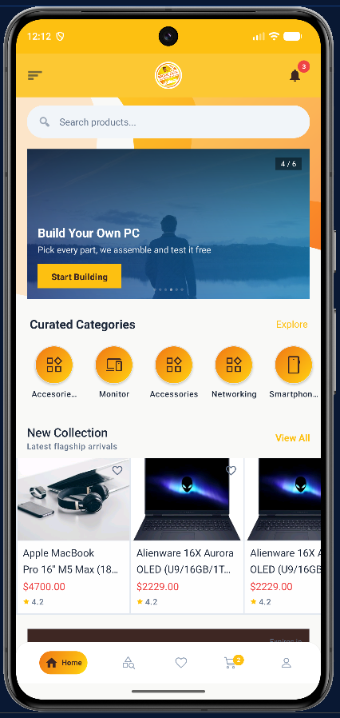
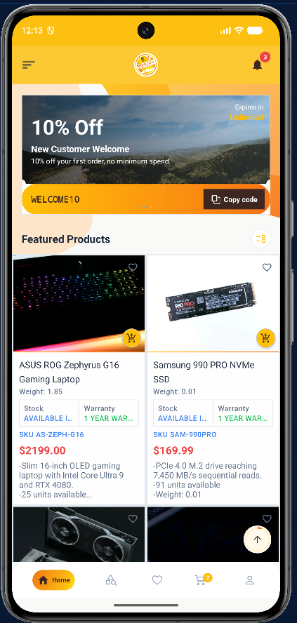
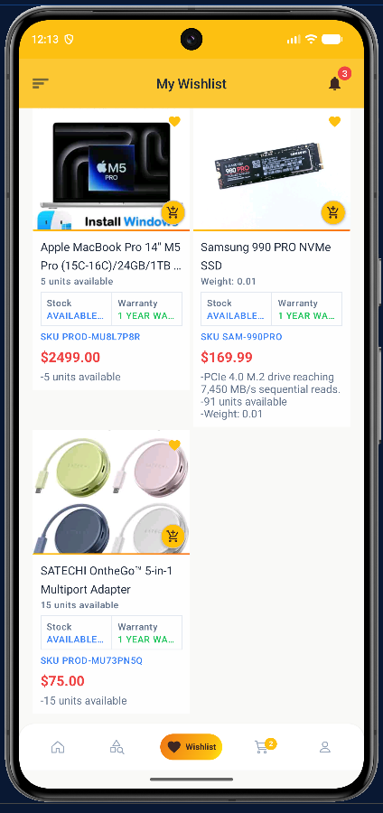
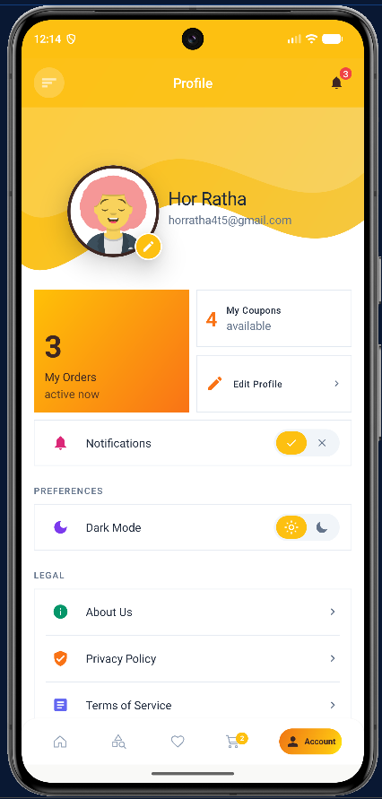

# 🛍️ Beckie Deal

<div align="center">
  
  
  **Your Premium Shopping Destination**
  
  *A modern e-commerce experience designed for style and convenience*
</div>

---

## 📱 App Preview

<div align="center">
  
### Home & Discover


### Browse & Explore


### Wishlist & Favorites


### Profile & Account


</div>

---

## ✨ Key Features

| Feature | Description |
|---------|-------------|
| 🎯 **Smart Browsing** | Intuitive product discovery with advanced search & filters |
| ❤️ **Wishlist** | Save your favorite items for later |
| 🛒 **Smart Cart** | Seamless shopping cart management |
| 💳 **Secure Checkout** | Multiple payment options with encryption |
| 🎟️ **Coupons & Deals** | Exclusive discounts and promotions |
| 👤 **User Profile** | Personalized account management |
| 🏷️ **Categories** | Browse by brands and product categories |

---

## 🚀 Getting Started

### Prerequisites
- **Android 5.0 (API 21)** or higher
- **Java 11** or higher
- **Gradle 7.0+**

### Installation

1. **Clone the Repository**
   ```bash
   git clone https://github.com/your-username/Beckie-Deal.git
   cd Beckie-Deal
   ```

2. **Open in Android Studio**
   - Open Android Studio
   - Select "Open" and navigate to the project folder
   - Wait for Gradle sync to complete

3. **Build & Run**
   - Connect an Android device or start an emulator
   - Click "Run" or press `Shift + F10`

---

## 📚 Project Architecture

```
Beckie-Deal/
├── app/src/main/
│   ├── java/aeu/ratha/beckie_deal_app/
│   │   ├── data/
│   │   │   ├── api/              # REST API Services
│   │   │   └── models/           # Data Models & Responses
│   │   ├── ui/                   # UI Screens & Fragments
│   │   ├── viewmodel/            # ViewModel Components
│   │   └── utils/                # Helper Utilities
│   ├── res/
│   │   ├── layout/               # XML Layouts
│   │   ├── drawable/             # Images & Drawables
│   │   └── values/               # Strings, Colors, Styles
│   └── AndroidManifest.xml
├── assets/                        # App Screenshots & Logo
└── build.gradle.kts              # Build Configuration
```

---

## 🛠️ Tech Stack

| Layer | Technology |
|-------|-----------|
| **Language** | Java |
| **Platform** | Android |
| **Build System** | Gradle |
| **HTTP Client** | Retrofit |
| **Image Loading** | Glide |
| **Architecture** | MVVM + Repository Pattern |

---

## 📡 API Services

The app includes comprehensive API integration:

- 🔐 **AuthApiService** - User authentication & login
- 🏪 **ProductApiService** - Product catalog & details
- 🛒 **CartApiService** - Shopping cart management
- 💳 **PaymentApiService** - Payment processing
- 🎟️ **CouponApiService** - Coupon & discount codes
- 💬 **CategoryApiService** - Product categories
- 🏷️ **BrandApiService** - Brand information
- 📦 **OrderApiService** - Order management
- ❤️ **WishlistApiService** - Wishlist management

---

## 🎨 UI Components

Modern, responsive UI with:
- Material Design principles
- Custom product cards
- Smooth animations
- Dark & Light theme support
- Intuitive navigation

---

## 📦 Build & Deployment

### Build APK
```bash
./gradlew assembleRelease
```

### Build AAB (Google Play)
```bash
./gradlew bundleRelease
```

---

## 🤝 Contributing

We welcome contributions! Please feel free to submit a Pull Request.

1. Fork the repository
2. Create your feature branch (`git checkout -b feature/AmazingFeature`)
3. Commit your changes (`git commit -m 'Add some AmazingFeature'`)
4. Push to the branch (`git push origin feature/AmazingFeature`)
5. Open a Pull Request

---

## 📄 License

This project is licensed under the MIT License - see the LICENSE file for details.

---

## 👥 Team & Contact

**Developed by:** Beckie Deal Team  
📧 **Email:** support@beckiedeal.com  
🌐 **Website:** www.beckiedeal.com  
📱 **Instagram:** @beckiedeal

---

<div align="center">
  
  Made with ❤️ for a better shopping experience
  
  ⭐ If you like this project, please give it a star!
  
</div>
