# ChatGPT Prompt for Complete ER Diagram Generation

## Full Prompt to Copy-Paste into ChatGPT

---

```
You are an expert database architect and visual designer. I need you to generate a COMPLETE, 
DETAILED Entity Relationship (ER) Diagram for a Beckie-Deal E-Commerce Mobile Application.

Generate this as MERMAID DIAGRAM CODE (not text description). The diagram should be 
production-ready for a thesis document.

REQUIREMENTS:
1. All 24 entities with complete attributes
2. All relationships (1:N, N:1, self-references)
3. Color coding by entity status (implemented vs planned)
4. Clear, professional layout
5. Readable attribute lists inside each entity box
6. Legend showing symbols and meanings
7. Implementation status indicators (✅ vs ⏳)

ENTITIES TO INCLUDE:

GROUP 1 - USER ENTITIES (✅ Implemented):
- USER: id, email, password_hash, first_name, last_name, phone, created_at, updated_at
- CUSTOMER_PROFILE: id, user_id (FK), address, city, state, postal_code, country, telegram, website, contact_person

GROUP 2 - CATALOG ENTITIES (✅ Implemented):
- CATEGORY: id, parent_id (FK self-ref), name, slug, description, image, icon, is_active, is_featured, sort_order
- BRAND: id, name, slug, logo, website, description, is_active, is_featured, sort_order
- PRODUCT: id, category_id (FK), brand_id (FK), name, slug, sku, barcode, description, price, sale_price, cost_price, stock_quantity, in_stock, is_active, is_featured, is_digital
- PRODUCT_IMAGE: id, product_id (FK), image_url, alt_text, sort_order, is_thumbnail
- PRODUCT_VARIANT: id, product_id (FK), name, sku, price, stock_quantity, attributes (JSON)

GROUP 3 - TRANSACTION ENTITIES (⏳ Pending API):
- CART: id, user_id (FK nullable), session_id, status, coupon_code, discount_total, subtotal, grand_total
- CART_ITEM: id, cart_id (FK), product_id (FK), variant_id (FK nullable), quantity, price, discount
- WISHLIST: id, user_id (FK nullable), session_id, name, description, is_public, is_active
- WISHLIST_ITEM: id, wishlist_id (FK), product_id (FK), variant_id (FK nullable), quantity
- ORDER: id, user_id (FK), order_no, date, total_amount, status, paid_amount, shipping_id (FK nullable), payment_id (FK nullable)
- ORDER_ITEM: id, order_id (FK), product_id (FK), product_name, product_price, product_image, quantity

GROUP 4 - SHIPPING & PAYMENT (⏳ Pending):
- SHIPPING_METHOD: id, name, description, cost, estimated_days, is_active
- ORDER_SHIPMENT: id, order_id (FK), shipping_id (FK), tracking_number, status, shipped_date, delivered_date
- PAYMENT: id, order_id (FK), payment_method, amount, status, transaction_id
- DISCOUNT: id, order_id (FK), discount_type, amount, reason

GROUP 5 - SUPPLIERS & PROMOTIONS (⏳ Pending):
- SUPPLIER: id, name, address, city, state, postal_code, country, phone, telegram, email, website, contact_person
- PRODUCT_SUPPLIER: id, product_id (FK), supplier_id (FK), supplier_code, lead_time_days, min_order_qty, unit_cost

GROUP 6 - REVIEWS & SUPPORT (⏳ Pending):
- COUPON: id, code, type, value, min_purchase_amount, max_discount_amount, valid_from, valid_until, usage_limit, is_active
- PRODUCT_REVIEW: id, user_id (FK), product_id (FK), rating (1-5), title, review_text, helpful_count
- NOTIFICATION: id, user_id (FK), type (promo/order/support/system), title, message, related_entity_type, related_entity_id, is_read
- SUPPORT_TICKET: id, user_id (FK), order_id (FK nullable), subject, category, priority, status, assigned_to, created_at, resolved_at
- SUPPORT_TICKET_REPLY: id, ticket_id (FK), user_id (FK), message, is_admin_reply, created_at

RELATIONSHIPS TO SHOW:
1. USER (1) ──► (N) CUSTOMER_PROFILE
2. USER (1) ──► (N) CART
3. USER (1) ──► (N) WISHLIST
4. USER (1) ──► (N) ORDER
5. USER (1) ──► (N) PRODUCT_REVIEW
6. USER (1) ──► (N) SUPPORT_TICKET
7. CATEGORY (1) ──► (N) PRODUCT
8. CATEGORY (1) ◄──┐ parent_id (self-reference)
9. BRAND (1) ──► (N) PRODUCT
10. PRODUCT (1) ──► (N) PRODUCT_IMAGE
11. PRODUCT (1) ──► (N) PRODUCT_VARIANT
12. PRODUCT (1) ──► (N) PRODUCT_SUPPLIER
13. PRODUCT (1) ──► (N) CART_ITEM
14. PRODUCT (1) ──► (N) WISHLIST_ITEM
15. PRODUCT (1) ──► (N) ORDER_ITEM
16. PRODUCT (1) ──► (N) PRODUCT_REVIEW
17. CART (1) ──► (N) CART_ITEM
18. WISHLIST (1) ──► (N) WISHLIST_ITEM
19. ORDER (1) ──► (N) ORDER_ITEM
20. ORDER (1) ──► (N) ORDER_SHIPMENT
21. ORDER (1) ──► (N) PAYMENT
22. ORDER (1) ──► (N) DISCOUNT
23. SHIPPING_METHOD (1) ──► (N) ORDER_SHIPMENT
24. SUPPLIER (1) ──► (N) PRODUCT_SUPPLIER
25. COUPON (1) ──► (N) NOTIFICATION
26. SUPPORT_TICKET (1) ──► (N) SUPPORT_TICKET_REPLY
27. SUPPORT_TICKET_REPLY ──► (1) NOTIFICATION

FORMATTING REQUIREMENTS:
- Use MERMAID.js syntax (erDiagram format)
- Color codes:
  * Green/Light Green for ✅ Implemented entities
  * Orange/Yellow for ⏳ Pending entities
  * Blue for User-related entities
  * Purple for Transaction entities
  * Red for Support entities
- Entity box format: 
  * ENTITY_NAME : "attributes"
- Relationship syntax:
  * ENTITY1 ||--o{ ENTITY2 : "relationship_name"
- Include attribute type hints in descriptions
- Add a legend explaining colors and symbols

OUTPUT FORMAT:
Generate complete Mermaid ER diagram code between triple backticks (```mermaid ... ```)
that I can copy directly into Mermaid Live Editor or a Markdown file.

VALIDATION CHECKLIST:
✓ All 24 entities included
✓ All attributes listed (no missing fields)
✓ All relationships connected
✓ No orphaned entities
✓ Color coding consistent
✓ Implementation status clear
✓ Ready for thesis document
✓ Renders without errors in Mermaid Live

NOW GENERATE THE COMPLETE MERMAID ER DIAGRAM CODE:
```

---

## How to Use This Prompt:

### **Step 1: Copy the Prompt**
- Copy the entire prompt above (from "You are an expert..." to the end)

### **Step 2: Paste into ChatGPT**
- Go to ChatGPT (https://chat.openai.com)
- Create a new chat
- Paste the entire prompt
- Send it

### **Step 3: Generate the Diagram**
- ChatGPT will generate Mermaid code
- The code will be in a code block (```mermaid ... ```)

### **Step 4: Copy the Mermaid Code**
- Copy the entire mermaid code block
- ChatGPT will give you something like:

```
```mermaid
erDiagram
    USER {
        string id
        string email
        ...
    }
    ...
```
```

### **Step 5: Render the Diagram**

**Option A: Mermaid Live Editor (Easiest)**
1. Go to https://mermaid.live
2. Paste the mermaid code
3. It renders immediately
4. Click "Download SVG" or "Download PNG" to save
5. Use in your thesis

**Option B: GitHub Markdown**
1. Create a `.md` file
2. Paste the code
3. GitHub renders it automatically
4. Screenshot it

**Option C: VS Code**
1. Install "Mermaid Markdown Syntax Highlighting" extension
2. Create file `diagram.md`
3. Paste mermaid code
4. Preview in VS Code

**Option D: Obsidian/Notion**
1. Paste mermaid code in code block
2. Set language to `mermaid`
3. Renders automatically

---

## Alternative Prompts (If you need variations):

### **Prompt 2: Simpler Version (Core Entities Only)**

```
Generate a simple ER diagram for Beckie-Deal E-Commerce with ONLY these core entities:
- USER, PRODUCT, CATEGORY, BRAND
- CART, CART_ITEM
- ORDER, ORDER_ITEM
- WISHLIST, WISHLIST_ITEM

Show all relationships and attributes.
Use Mermaid syntax.
Format for thesis.
```

### **Prompt 3: Detailed with Examples**

```
Create a detailed ER diagram with:
1. All 24 entities for Beckie-Deal e-commerce
2. Data types for each attribute (UUID, String, Integer, Decimal, DateTime, Boolean, JSON, Enum)
3. Primary keys (PK) marked with 🔑
4. Foreign keys (FK) marked with 🔗
5. Nullable fields marked with ❓
6. Relationships with cardinality (1:1, 1:N, N:M)
7. Example values for sample entities

Use Mermaid erDiagram format.
Output must be valid Mermaid syntax.
```

### **Prompt 4: Visual Layout Optimized**

```
Generate a well-organized ER diagram where:
1. User entities (top left)
2. Catalog entities (top center)
3. Transaction entities (bottom left)
4. Support entities (bottom right)
5. Clear visual separation between groups
6. All relationships drawn with proper cardinality
7. Different colors for implemented (green) vs pending (orange) entities

Use Mermaid syntax.
```

---

## Expected Output from ChatGPT:

You should receive something like:

```mermaid
erDiagram
    USER {
        uuid id PK
        string email UK
        string password_hash
        string first_name
        string last_name
        string phone
        datetime created_at
        datetime updated_at
    }

    CUSTOMER_PROFILE {
        uuid id PK
        uuid user_id FK
        string address
        string city
        string state
        string postal_code
        string country
        string telegram
        string website
        string contact_person
    }

    CATEGORY {
        uuid id PK
        uuid parent_id FK "nullable"
        string name
        string slug UK
        string description
        string image
        string icon
        boolean is_active
        boolean is_featured
        int sort_order
    }

    BRAND {
        uuid id PK
        string name
        string slug UK
        string logo
        string website
        string description
        boolean is_active
        boolean is_featured
        int sort_order
    }

    PRODUCT {
        uuid id PK
        uuid category_id FK
        uuid brand_id FK
        string name
        string slug UK
        string sku UK
        string barcode
        text description
        decimal price
        decimal sale_price
        decimal cost_price
        int stock_quantity
        boolean in_stock
        boolean is_active
        boolean is_featured
        boolean is_digital
    }

    PRODUCT_IMAGE {
        uuid id PK
        uuid product_id FK
        string image_url
        string alt_text
        int sort_order
        boolean is_thumbnail
    }

    PRODUCT_VARIANT {
        uuid id PK
        uuid product_id FK
        string name
        string sku UK
        decimal price
        int stock_quantity
        json attributes
    }

    CART {
        uuid id PK
        uuid user_id FK "nullable"
        string session_id
        string status
        string coupon_code
        decimal discount_total
        decimal subtotal
        decimal grand_total
    }

    CART_ITEM {
        uuid id PK
        uuid cart_id FK
        uuid product_id FK
        uuid variant_id FK "nullable"
        int quantity
        decimal price
        decimal discount
    }

    WISHLIST {
        uuid id PK
        uuid user_id FK "nullable"
        string session_id
        string name
        string description
        boolean is_public
        boolean is_active
    }

    WISHLIST_ITEM {
        uuid id PK
        uuid wishlist_id FK
        uuid product_id FK
        uuid variant_id FK "nullable"
        int quantity
    }

    ORDER {
        string id PK
        uuid user_id FK
        string order_no UK
        datetime date
        decimal total_amount
        string status
        decimal paid_amount
        uuid shipping_id FK "nullable"
        uuid payment_id FK "nullable"
    }

    ORDER_ITEM {
        uuid id PK
        string order_id FK
        uuid product_id FK
        string product_name
        decimal product_price
        string product_image
        int quantity
    }

    SHIPPING_METHOD {
        uuid id PK
        string name
        string description
        decimal cost
        int estimated_days
        boolean is_active
    }

    ORDER_SHIPMENT {
        uuid id PK
        string order_id FK
        uuid shipping_id FK
        string tracking_number
        string status
        datetime shipped_date
        datetime delivered_date
    }

    PAYMENT {
        uuid id PK
        string order_id FK
        string payment_method
        decimal amount
        string status
        string transaction_id
    }

    DISCOUNT {
        uuid id PK
        string order_id FK
        string discount_type
        decimal amount
        string reason
    }

    SUPPLIER {
        uuid id PK
        string name
        string address
        string city
        string state
        string postal_code
        string country
        string phone
        string telegram
        string email
        string website
        string contact_person
    }

    PRODUCT_SUPPLIER {
        uuid id PK
        uuid product_id FK
        uuid supplier_id FK
        string supplier_code
        int lead_time_days
        int min_order_qty
        decimal unit_cost
    }

    COUPON {
        uuid id PK
        string code UK
        string type
        decimal value
        decimal min_purchase_amount
        decimal max_discount_amount
        datetime valid_from
        datetime valid_until
        int usage_limit
        boolean is_active
    }

    PRODUCT_REVIEW {
        uuid id PK
        uuid user_id FK
        uuid product_id FK
        int rating
        string title
        text review_text
        int helpful_count
    }

    NOTIFICATION {
        uuid id PK
        uuid user_id FK
        string type
        string title
        string message
        string related_entity_type
        string related_entity_id
        boolean is_read
    }

    SUPPORT_TICKET {
        uuid id PK
        uuid user_id FK
        string order_id FK "nullable"
        string subject
        string category
        string priority
        string status
        string assigned_to
        datetime created_at
        datetime resolved_at
    }

    SUPPORT_TICKET_REPLY {
        uuid id PK
        uuid ticket_id FK
        uuid user_id FK
        text message
        boolean is_admin_reply
        datetime created_at
    }

    USER ||--o{ CUSTOMER_PROFILE : "has"
    USER ||--o{ CART : "owns"
    USER ||--o{ WISHLIST : "owns"
    USER ||--o{ ORDER : "places"
    USER ||--o{ PRODUCT_REVIEW : "writes"
    USER ||--o{ SUPPORT_TICKET : "creates"

    CATEGORY ||--o{ PRODUCT : "contains"
    CATEGORY o|--|| CATEGORY : "parent_of"

    BRAND ||--o{ PRODUCT : "offers"

    PRODUCT ||--o{ PRODUCT_IMAGE : "has"
    PRODUCT ||--o{ PRODUCT_VARIANT : "has_variants"
    PRODUCT ||--o{ PRODUCT_SUPPLIER : "supplied_by"
    PRODUCT ||--o{ CART_ITEM : "in_cart"
    PRODUCT ||--o{ WISHLIST_ITEM : "in_wishlist"
    PRODUCT ||--o{ ORDER_ITEM : "in_order"
    PRODUCT ||--o{ PRODUCT_REVIEW : "reviewed_by"

    CART ||--o{ CART_ITEM : "contains"
    WISHLIST ||--o{ WISHLIST_ITEM : "contains"

    ORDER ||--o{ ORDER_ITEM : "contains"
    ORDER ||--o{ ORDER_SHIPMENT : "has"
    ORDER ||--o{ PAYMENT : "receives"
    ORDER ||--o{ DISCOUNT : "has"

    SHIPPING_METHOD ||--o{ ORDER_SHIPMENT : "used_for"

    SUPPLIER ||--o{ PRODUCT_SUPPLIER : "provides"

    COUPON ||--o{ NOTIFICATION : "triggers"
    SUPPORT_TICKET ||--o{ SUPPORT_TICKET_REPLY : "has"
    SUPPORT_TICKET_REPLY ||--o{ NOTIFICATION : "triggers"
```



---

## How to Save and Use:

### **Option 1: Save as Markdown**
1. Create file: `ER_Diagram_Final.md`
2. Paste the mermaid code
3. Include in your thesis

### **Option 2: Export as Image**
1. Go to Mermaid Live Editor
2. Paste mermaid code
3. Right-click → "Download as SVG"
4. Insert SVG into thesis document

### **Option 3: Export as PNG**
1. Mermaid Live Editor
2. Click "Download PNG"
3. Use in PowerPoint, Word, Google Docs

---

## Troubleshooting:

| Issue | Solution |
|-------|----------|
| ChatGPT gives JSON instead of Mermaid | Ask: "Can you format this as Mermaid erDiagram code?" |
| Mermaid won't render | Check syntax: use \|\|--o{ for 1:N relationships |
| Diagram too cluttered | Ask ChatGPT for "separated layout by entity groups" |
| Missing attributes | Tell ChatGPT: "Add all 24 entities with complete attributes" |
| Colors not showing | Mermaid doesn't support custom colors in erDiagram, but layout is clear |

---

## Final Steps for Thesis:

1. ✅ Generate diagram from ChatGPT
2. ✅ Render in Mermaid Live
3. ✅ Export as SVG/PNG
4. ✅ Insert into thesis document (Word/PDF/Google Docs)
5. ✅ Add caption: "Figure X: Beckie-Deal E-Commerce ER Diagram v2.0"
6. ✅ Reference in text: "As shown in Figure X, the system has 24 entities organized into 6 groups..."
7. ✅ Include legend explaining colors, symbols, and implementation status

---

Good luck! 🚀
