# Beckie-Deal ER Diagram - Mermaid Format (Ready to Use)

## How to Use This Diagram

**Option 1: Mermaid Live Editor (Easiest)**
1. Go to https://mermaid.live
2. Delete the default code
3. Copy the entire code block below (all the mermaid code)
4. Paste into Mermaid Live Editor
5. See the diagram render automatically
6. Click "Download SVG" or "Download PNG" to save

**Option 2: GitHub**
1. Create a new file: `er-diagram.md`
2. Paste this code into it
3. GitHub will render it automatically

**Option 3: VS Code**
1. Install extension: "Mermaid Markdown Syntax Highlighting"
2. Create file: `diagram.md`
3. Paste this code
4. Preview in VS Code

---

## Complete ER Diagram - Mermaid Code

Copy everything between the triple backticks below:

```mermaid
erDiagram
    USER {
        string id PK "UUID"
        string email UK "unique"
        string password_hash
        string first_name
        string last_name
        string phone
        string created_at
        string updated_at
    }

    CUSTOMER_PROFILE {
        string id PK "UUID"
        string user_id FK "references USER"
        string address
        string city
        string state
        string postal_code
        string country
        string telegram
        string website
        string contact_person
    }

    CATEGORY {
        string id PK "UUID"
        string parent_id FK "self-reference, nullable"
        string name
        string slug UK
        string description
        string image
        string icon
        boolean is_active "default: true"
        boolean is_featured "default: false"
        int sort_order
    }

    BRAND {
        string id PK "UUID"
        string name
        string slug UK
        string logo
        string website
        string description
        boolean is_active
        boolean is_featured
        int sort_order
    }

    PRODUCT {
        string id PK "UUID"
        string category_id FK "references CATEGORY"
        string brand_id FK "references BRAND"
        string name
        string slug UK
        string sku UK
        string barcode
        string description
        decimal price
        decimal sale_price "nullable"
        decimal cost_price "nullable"
        int stock_quantity
        boolean in_stock
        boolean is_active
        boolean is_featured
        boolean is_digital
        int views_count
        int sales_count
    }

    PRODUCT_IMAGE {
        string id PK "UUID"
        string product_id FK "references PRODUCT"
        string image_url
        string alt_text
        int sort_order
        boolean is_thumbnail
    }

    PRODUCT_VARIANT {
        string id PK "UUID"
        string product_id FK "references PRODUCT"
        string name
        string sku UK
        decimal price
        int stock_quantity
        string attributes "JSON"
    }

    CART {
        string id PK "UUID"
        string user_id FK "nullable, references USER"
        string session_id "for guest carts"
        string status "active/completed/abandoned"
        string coupon_code "nullable"
        decimal discount_total
        decimal subtotal
        decimal grand_total
    }

    CART_ITEM {
        string id PK "UUID"
        string cart_id FK "references CART"
        string product_id FK "references PRODUCT"
        string variant_id FK "nullable, references PRODUCT_VARIANT"
        int quantity
        decimal price
        decimal discount "nullable"
    }

    WISHLIST {
        string id PK "UUID"
        string user_id FK "nullable, references USER"
        string session_id "for guest wishlists"
        string name
        string description
        boolean is_public
        boolean is_active
    }

    WISHLIST_ITEM {
        string id PK "UUID"
        string wishlist_id FK "references WISHLIST"
        string product_id FK "references PRODUCT"
        string variant_id FK "nullable, references PRODUCT_VARIANT"
        int quantity
    }

    ORDER {
        string id PK "order number like BD-1001"
        string user_id FK "references USER"
        string order_no UK
        string date
        decimal total_amount
        string status "PROCESSING/SHIPPED/DELIVERED/CANCELLED"
        decimal paid_amount
        string shipping_id FK "nullable, references SHIPPING_METHOD"
        string payment_id FK "nullable, references PAYMENT"
    }

    ORDER_ITEM {
        string id PK "UUID"
        string order_id FK "references ORDER"
        string product_id FK "references PRODUCT"
        string product_name "snapshot"
        decimal product_price "snapshot at time of order"
        string product_image "snapshot"
        int quantity
    }

    SHIPPING_METHOD {
        string id PK "UUID"
        string name
        string description
        decimal cost
        int estimated_days
        boolean is_active
    }

    ORDER_SHIPMENT {
        string id PK "UUID"
        string order_id FK "references ORDER"
        string shipping_id FK "references SHIPPING_METHOD"
        string tracking_number "nullable"
        string status "pending/shipped/in_transit/delivered"
        string shipped_date "nullable"
        string delivered_date "nullable"
    }

    PAYMENT {
        string id PK "UUID"
        string order_id FK "references ORDER"
        string payment_method "card/bank/wallet/cash"
        decimal amount
        string status "pending/completed/failed"
        string transaction_id "nullable"
    }

    DISCOUNT {
        string id PK "UUID"
        string order_id FK "references ORDER"
        string discount_type
        decimal amount
        string reason "nullable"
    }

    SUPPLIER {
        string id PK "UUID"
        string name
        string address
        string city
        string state
        string postal_code
        string country
        string phone
        string telegram
        string email
        string website
        string contact_person
    }

    PRODUCT_SUPPLIER {
        string id PK "UUID"
        string product_id FK "references PRODUCT"
        string supplier_id FK "references SUPPLIER"
        string supplier_code
        int lead_time_days
        int min_order_qty
        decimal unit_cost
    }

    COUPON {
        string id PK "UUID"
        string code UK
        string type "percentage/fixed_amount/buy_x_get_y"
        decimal value
        decimal min_purchase_amount
        decimal max_discount_amount "nullable"
        string valid_from
        string valid_until
        int usage_limit "nullable"
        int used_count
        boolean is_active
    }

    PRODUCT_REVIEW {
        string id PK "UUID"
        string user_id FK "references USER"
        string product_id FK "references PRODUCT"
        int rating "1-5"
        string title
        string review_text
        int helpful_count
    }

    NOTIFICATION {
        string id PK "UUID"
        string user_id FK "references USER"
        string type "promo/order/support/system"
        string title
        string message
        string related_entity_type "promotion/order/ticket/etc"
        string related_entity_id "promotion_id/order_id/ticket_id"
        boolean is_read
    }

    SUPPORT_TICKET {
        string id PK "UUID"
        string user_id FK "references USER"
        string order_id FK "nullable, references ORDER"
        string subject
        string category "product/delivery/payment/return/other"
        string priority "low/medium/high/urgent"
        string status "open/in_progress/resolved/closed"
        string assigned_to "nullable, admin user"
        string created_at
        string resolved_at "nullable"
    }

    SUPPORT_TICKET_REPLY {
        string id PK "UUID"
        string ticket_id FK "references SUPPORT_TICKET"
        string user_id FK "references USER, admin or customer"
        string message
        boolean is_admin_reply
        string created_at
    }

    %% USER Relationships
    USER ||--o{ CUSTOMER_PROFILE : "has"
    USER ||--o{ CART : "owns"
    USER ||--o{ WISHLIST : "owns"
    USER ||--o{ ORDER : "places"
    USER ||--o{ PRODUCT_REVIEW : "writes"
    USER ||--o{ SUPPORT_TICKET : "creates"

    %% CATEGORY Relationships
    CATEGORY ||--o{ PRODUCT : "contains"
    CATEGORY o|--|| CATEGORY : "parent_of"

    %% BRAND Relationships
    BRAND ||--o{ PRODUCT : "offers"

    %% PRODUCT Relationships
    PRODUCT ||--o{ PRODUCT_IMAGE : "has"
    PRODUCT ||--o{ PRODUCT_VARIANT : "has_variants"
    PRODUCT ||--o{ PRODUCT_SUPPLIER : "supplied_by"
    PRODUCT ||--o{ CART_ITEM : "in_cart"
    PRODUCT ||--o{ WISHLIST_ITEM : "in_wishlist"
    PRODUCT ||--o{ ORDER_ITEM : "in_order"
    PRODUCT ||--o{ PRODUCT_REVIEW : "reviewed_by"

    %% CART Relationships
    CART ||--o{ CART_ITEM : "contains"

    %% WISHLIST Relationships
    WISHLIST ||--o{ WISHLIST_ITEM : "contains"

    %% ORDER Relationships
    ORDER ||--o{ ORDER_ITEM : "contains"
    ORDER ||--o{ ORDER_SHIPMENT : "has"
    ORDER ||--o{ PAYMENT : "receives"
    ORDER ||--o{ DISCOUNT : "has"

    %% SHIPPING Relationships
    SHIPPING_METHOD ||--o{ ORDER_SHIPMENT : "used_for"

    %% SUPPLIER Relationships
    SUPPLIER ||--o{ PRODUCT_SUPPLIER : "provides"

    %% PROMOTION & NOTIFICATION
    COUPON ||--o{ NOTIFICATION : "triggers"

    %% SUPPORT Relationships
    SUPPORT_TICKET ||--o{ SUPPORT_TICKET_REPLY : "has"
    SUPPORT_TICKET_REPLY ||--o{ NOTIFICATION : "triggers"
```

---

## How to Read This Diagram

### Symbols:
- `||--o{` = One-to-Many (1:N) - "one PRODUCT has many PRODUCT_IMAGEs"
- `}o--||` = Many-to-One (N:1) - reverse of above
- `o|--||` = Optional/Nullable relationship

### Implementation Status:
- ✅ **IMPLEMENTED** (working in app):
  - USER
  - PRODUCT, CATEGORY, BRAND
  - PRODUCT_IMAGE, PRODUCT_VARIANT

- ⏳ **DESIGNED** (API endpoints pending):
  - CART, CART_ITEM
  - WISHLIST, WISHLIST_ITEM
  - ORDER, ORDER_ITEM
  - SHIPPING_METHOD, ORDER_SHIPMENT
  - PAYMENT, DISCOUNT
  - COUPON
  - PRODUCT_REVIEW
  - NOTIFICATION
  - SUPPORT_TICKET, SUPPORT_TICKET_REPLY
  - SUPPLIER, PRODUCT_SUPPLIER

### Key Features:
1. **User Management**: USER + CUSTOMER_PROFILE
2. **Product Catalog**: CATEGORY, BRAND, PRODUCT, PRODUCT_IMAGE, PRODUCT_VARIANT
3. **Shopping**: CART, CART_ITEM, WISHLIST, WISHLIST_ITEM
4. **Orders**: ORDER, ORDER_ITEM, ORDER_SHIPMENT, PAYMENT, DISCOUNT
5. **Support**: SUPPLIER, PRODUCT_SUPPLIER, COUPON
6. **Communication**: NOTIFICATION, PRODUCT_REVIEW
7. **Customer Service**: SUPPORT_TICKET, SUPPORT_TICKET_REPLY

---

## Total Entities: 24

| Group | Count | Entities |
|-------|-------|----------|
| User | 2 | USER, CUSTOMER_PROFILE |
| Catalog | 5 | CATEGORY, BRAND, PRODUCT, PRODUCT_IMAGE, PRODUCT_VARIANT |
| Shopping | 4 | CART, CART_ITEM, WISHLIST, WISHLIST_ITEM |
| Orders | 6 | ORDER, ORDER_ITEM, SHIPPING_METHOD, ORDER_SHIPMENT, PAYMENT, DISCOUNT |
| Support | 4 | COUPON, PRODUCT_REVIEW, NOTIFICATION |
| Service | 3 | SUPPLIER, PRODUCT_SUPPLIER, SUPPORT_TICKET, SUPPORT_TICKET_REPLY |
| **TOTAL** | **24** | |

---

## Save This Diagram

1. Copy the mermaid code (the section in triple backticks)
2. Go to https://mermaid.live
3. Paste the code
4. Export as PNG or SVG
5. Use in your thesis!

Ready to go! 🚀
